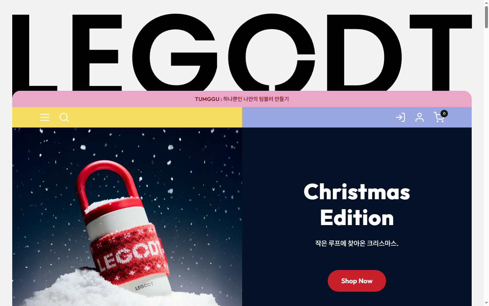
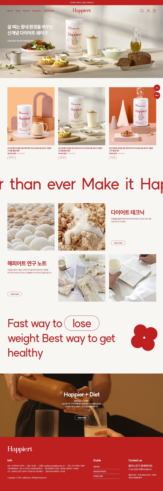
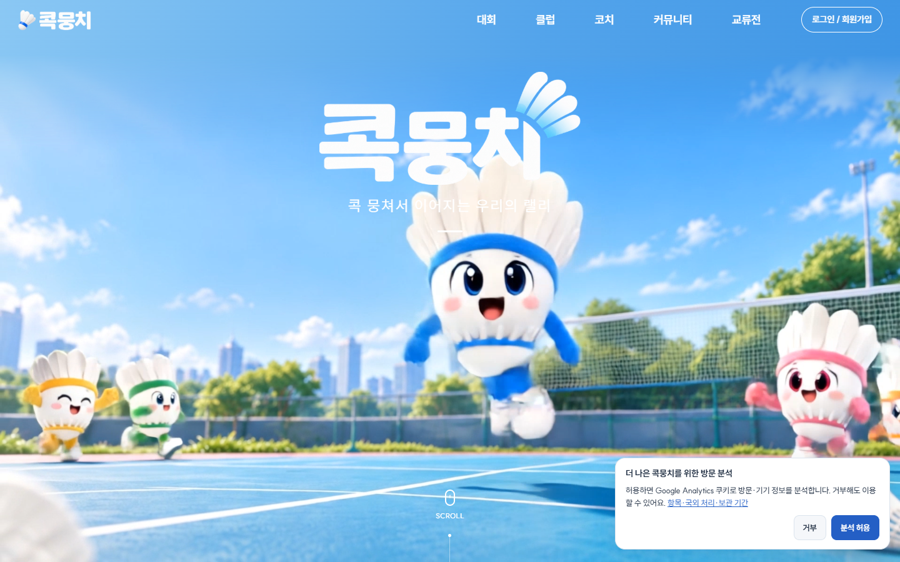
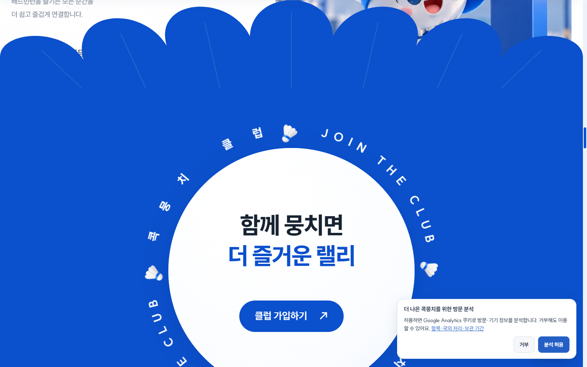
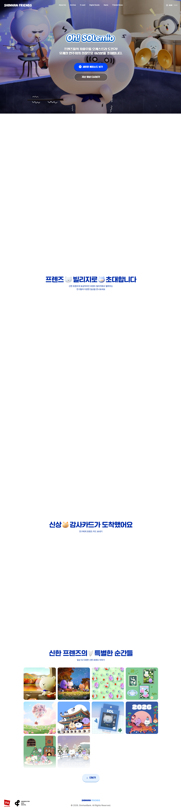
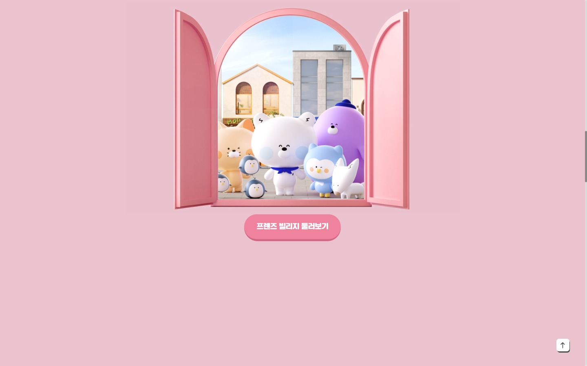
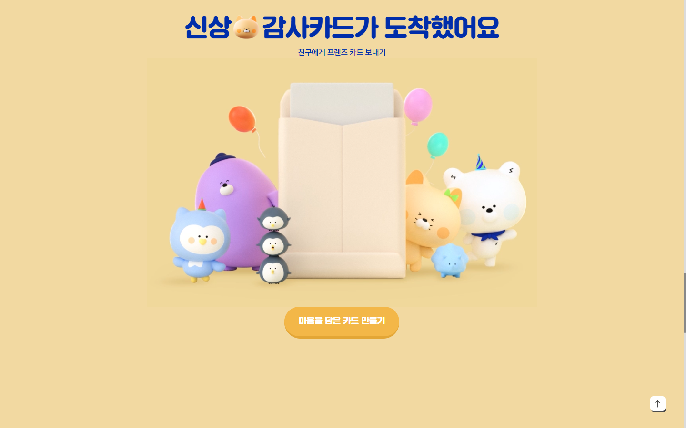
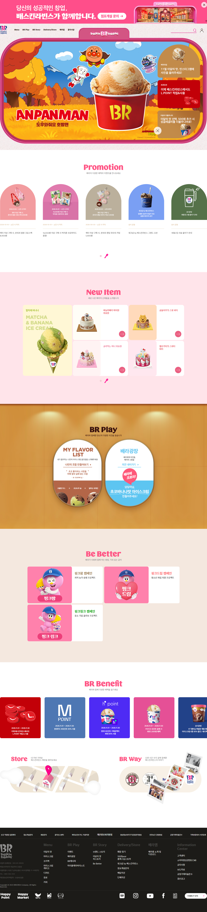
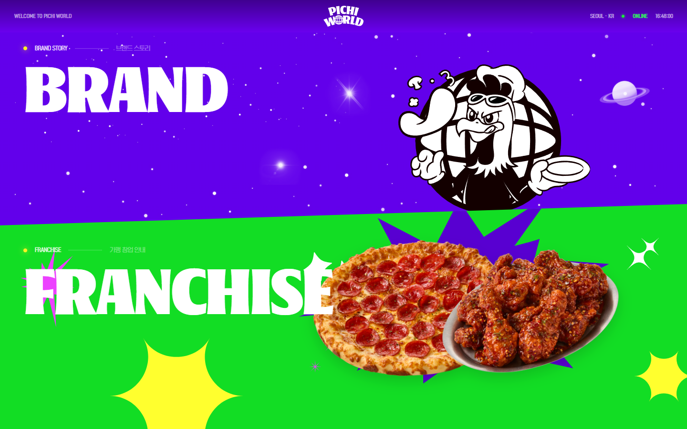
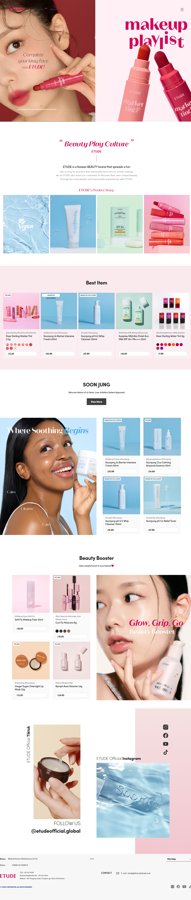

# LEGODT (Korean customizable tumbler brand) — Web design references

- Date: 2026-11-01
- Material: `output/research/legodt/legodt-research-v1.md` (brand introduction page for LEGODT; playful, colorful, pop tone for 20s–30s (MZ) and K-pop fans; milky pastel palette with vitamin-color accents; TUMGGU = tumbler + decorate)
- Sources: GDWEB, DBCUT (Pinterest not used)

## Summary

- The strongest references for this brand mix **big, bold display type** with **soft pastel color blocks** and **one or two saturated accents**. LEGODT's own store (ref 1) already does this with a giant black wordmark over pink, yellow, and periwinkle bars.
- **Rounded shapes everywhere**: pill buttons, arch-topped cards (Baskin Robbins), fully rounded panels and window frames (Shinhan Friends), and scalloped section edges (Kokmoongchi). This fits a tumbler with a loop handle.
- **The background changes color by section** (Shinhan Friends: pink → butter; Baskin Robbins: white → pink → wood → cream). This works well for a "pick your color" brand.
- **Product cards with color swatch dots** (LEGODT, Etude, Baskin Robbins) are the common pattern for showing one product in many colors.
- Recommended direction: a milk-white base, pastel section bands (pink, mint, light blue, apple green, butter, lavender), heavy rounded display type, vitamin-color stickers and badges, and playful motion (charms that swing, stickers that pop on, a marquee of taglines).

## Content to present

From the research note:

- **Hero:** "Dress Up Your Tumbler" / "Make it pop. Make it you." with the TUMGGU idea (tumbler + decorate).
- **Brand story:** launched by Odense (Brandworks Korea, CJ ENM); from a colorful modular tableware line (2022) to a tumbler-led lifestyle brand (2023); "choose, combine, complete".
- **Features (numbers):** 6-hour hot/cold retention, spill-proof lid, ergonomic loop handle, stainless steel 304, 400ml–1L, 28 modular parts, 180+ designs.
- **How to customize (5 steps):** pick a tumbler → swap sleeve/parts → add charms and keyrings → finish with stickers and straps → preview in 3D.
- **Lineup:** Loop Tumbler, Loop Tumbler Multi, Two-way Loop Tumbler, Tritan, modular tumbler, TUMGGU accessories; named colors (pink, mint, light gray, light blue, apple green, butter cream, lavender, orange carrot, vanilla).
- **Collaborations:** Pokémon, Mangom x Olive Young, PLUPPY (plus POCA-i at Japan pop-ups).
- **Pop-up timeline:** 11 dated pop-ups in Korea and Japan, 2024 to October 2026.
- **Where to buy:** Korea (official store, Odense, 29CM, Musinsa, Olive Young, Kurly) and Japan (legodt.jp and pop-ups only).
- **FAQ:** physical store in Japan, insulation time, what TUMGGU is, materials, dishwasher safety (not confirmed).
- **SNS footer:** @legodt.official (KR), @legodt.japan (JP), KakaoTalk channel.

## Reference list

| # | Title | Site | Gallery link | Live site | Image |
|---|---|---|---|---|---|
| 1 | LEGODT official store (레고트) | GDWEB | https://www.gdweb.co.kr/sub/view.asp?Txt_fgbn=5&str_no=25098 | https://legodt.kr/ | `images/legodt-reference-v1-1.png`, `-1a.png` |
| 2 | Happiert (해피어트) | GDWEB | https://www.gdweb.co.kr/sub/view.asp?Txt_fgbn=5&str_no=23614 | https://happiert.com/ | `images/legodt-reference-v1-2.png` |
| 3 | Kokmoongchi (콕뭉치) | GDWEB (also on DBCUT: https://www.dbcut.com/websites/25961) | https://www.gdweb.co.kr/sub/view.asp?Txt_fgbn=5&str_no=27800 | https://kokmoongchi.com | `images/legodt-reference-v1-3.png`, `-3a.png`, `-3b.png` |
| 4 | Shinhan Friends (신한프렌즈) | GDWEB | https://www.gdweb.co.kr/sub/view.asp?Txt_fgbn=5&str_no=24009 | https://www.shinhanfriends.com/ | `images/legodt-reference-v1-4.png`, `-4a.png`, `-4b.png` |
| 5 | Baskin Robbins (배스킨라빈스) | DBCUT | https://www.dbcut.com/websites/25315 | https://www.baskinrobbins.co.kr/ | `images/legodt-reference-v1-5.png` |
| 6 | Pichi World (피치월드) | DBCUT | https://www.dbcut.com/websites/25793 | https://pichiworld.co.kr/ | `images/legodt-reference-v1-6.png` |
| 7 | ETUDE Global (에뛰드 글로벌) | DBCUT | https://www.dbcut.com/websites/25237 | https://www.etude.com/int/en/index.php (redirects to https://int.etude.com/) | `images/legodt-reference-v1-7.png` |

Gallery dates: 1 — GDWEB 2025-06-24 (WINNER PRIZE; concept tags "cute, fun, flashy", main colors orange and pink). 2 — GDWEB 2024-11-28 (GRAND PRIZE; "cute, fun, flashy", red). 3 — GDWEB 2026-10-14 (WINNER PRIZE; "cute, dynamic, fun", blue). 4 — GDWEB 2025-02-04 (WINNER PRIZE; "cute", blue). 5 — DBCUT 2023-12-15. 6 — DBCUT, date not shown. 7 — DBCUT 2023-11-09.

All screenshots were taken at a 1440px-wide viewport on 2026-11-01. Live sites change, so the screenshots show the state on that date.

## Reference analysis

### 1. LEGODT official store (레고트)

- Links: https://www.gdweb.co.kr/sub/view.asp?Txt_fgbn=5&str_no=25098, https://legodt.kr/
- Note: this is the brand's own current store. It shows the existing visual language. Use it to stay consistent with the brand, not as a layout to copy.
- Layout: a giant full-width black wordmark sits on top. Below it, a rounded-top frame (inset about 36px from each side) holds a pink announcement bar ("TUMGGU : …"), a two-color nav bar (yellow left half, periwinkle right half), and a 50/50 split hero (product photo left, solid color panel with headline and CTA right). After that come centered sections: Shop by Category (5 round-cornered photo tiles), a "Make Your Own" area, Loved By You (numbered ranking grid, 4 columns), a full-bleed blue "New In" product banner, Fresh Start (tabbed product grid), a split banner, Catalogue (3 photo cards), Shop the Video (carousel on a pink band), Promotion, an Instagram call-out, and a yellow footer with a large outlined slogan. The page is about 11,850px tall.
- Color: pink `#E9A8C5` (announcement bar and bands), light pink `#EFD5E1`, hot pink `#F65783`, light blue `#AECFF1`, blue-gray `#C0D0DF`, blue `#4488BA`, off-white page `#F4F2F3`, dark `#1A1A1A`. Seasonal hero: navy `#041127` with red `#C8202B` CTA. The yellow and periwinkle nav halves and the yellow footer are about `#F5DC64` and `#99A6E0` (approximate, read from the screenshot; not confirmed in CSS).
- Typography: Outfit for almost all text (bold geometric sans; hero headline about 60px bold, white on color), Nanum Gothic as a fallback. Section titles are centered, medium size, in pink.
- Imagery and graphics: studio product photos of stacked tumblers in pastel colors, lifestyle photos with bags and suitcases, a short product video carousel.
- Components: announcement bar, split hero slider with dots, category tiles, ranking cards with big numerals and color swatch dots, pill "More" buttons, tabbed product grid, video carousel, Instagram block, footer.
- Interaction: hero slider rotates (the first screenshot showed "Christmas Edition", the full-page one "Playful Modular Life"); lazy-loaded sections fade in on scroll (the "Make Your Own" area was still blank when captured).
- Responsive: not checked.
- What to borrow: the oversized wordmark, the multi-color bar header, swatch dots under each tumbler, and the pink/yellow/periwinkle combination as a base. Fix the weak spot: the store has no clear story, steps, or timeline, which the new page must add.

### 2. Happiert (해피어트)

- Links: https://www.gdweb.co.kr/sub/view.asp?Txt_fgbn=5&str_no=23614, https://happiert.com/
- Layout: thin red top banner, transparent header over a full-width photo hero with left-aligned headline. Then a 3-column product row on cream, a huge red marquee line of English text, an asymmetric 3-column photo/text grid (text blocks swap sides per row), a large typographic statement with a word framed in an outlined pill and a red flower graphic, a full-bleed photo band with centered copy, and a solid red footer. About 4,300px tall, lots of whitespace.
- Color: red `#BE201F` (text, outlines, footer), cream `#F1EBE4` background, light gray `#EDEDED`, white. Product photos add warm orange and peach.
- Typography: SUIT (Korean/Latin sans), with Noto Sans KR. English statements are very large (size not measured) in red; Korean section heads are medium bold red.
- Imagery and graphics: styled product still-lifes on colored plinths, close-up texture photos, one simple flower shape.
- Components: product cards with discount pill tags, outlined pill "view more" buttons, floating round Q&A and top buttons.
- Interaction: horizontal marquee text; other effects not observed.
- Responsive: not checked.
- What to borrow: the **marquee band** of slogans ("Make it pop. Make it you. · TUMGGU · Dress Up Your Tumbler"), the **word inside an outlined pill** inside a big headline, and product photos on colored geometric plinths. Swap the single red for LEGODT's multi-pastel palette.

### 3. Kokmoongchi (콕뭉치)

- Links: https://www.gdweb.co.kr/sub/view.asp?Txt_fgbn=5&str_no=27800, https://kokmoongchi.com
- Layout: full-screen 3D-character video hero with a large white logo and a "SCROLL" cue. Next, "Why it's special": a sticky left column with a numbered accordion list (01–04) and a right column of tall rounded image cards that scroll past. Then a blue section with a **scalloped top edge** (shuttlecock-feather shape) and a white circle with **text running around it** ("JOIN THE CLUB") and a pill CTA. Then four feature rows with phone/UI mockups, a two-line outlined/solid marquee on black, an app download block with a phone mockup, a dark statement section where words light up on scroll, and a feedback section with two cards. About 14,500px tall.
- Color: primary blue `#0B50CC`, pale blues `#E3EDFF`, `#EDF4FF`, `#F5F8FF`, near-white `#FAFAFF`, heading navy `#152237`, black `#101114`. Mascot accents in pink, yellow, and green.
- Typography: SUIT Variable only. H2 about 58–66px, weight 800, two lines with the second line in blue; list items 18.7px/800; body regular gray.
- Imagery and graphics: cute 3D mascot renders (one per color: blue, pink, yellow, green), sports-court photography, shuttlecock icons.
- Components: numbered accordion, sticky scroll cards, circular text badge, pill buttons with an arrow, phone mockups, marquee, cookie banner.
- Interaction: hero video loop, sticky scroll storytelling, spinning circular text, scroll-reveal for feature rows (several were blank in the full-page capture until scrolled into view), text highlight on scroll.
- Responsive: not checked.
- What to borrow: the **sticky numbered list + scrolling cards** pattern for the 5-step customize section, the **rotating circular text badge** ("TUMGGU · TUMBLER + DECORATE ·") as a sticker, scalloped or wavy section edges, and the idea of one mascot or charm per color.

### 4. Shinhan Friends (신한프렌즈)

- Links: https://www.gdweb.co.kr/sub/view.asp?Txt_fgbn=5&str_no=24009, https://www.shinhanfriends.com/
- Layout: full-screen 3D animated hero with a rounded logo-type title and two stacked pill CTAs. Then long scroll-pinned scenes, each centered: a title with inline character emoji, a large illustration (a pink arched window opening onto the character village), and one pill CTA. A gallery ("special moments") follows as a 4-column grid of rounded square tiles with a "more" pill. Minimal footer. The full-page capture shows large empty areas because the scenes are pinned and animated on scroll.
- Color: heading blue `#002DAA`; section backgrounds change per scene: pink (about `#EBC3CF`, approximate) with a pink CTA (about `#EE84A0`, approximate), butter `#F2D9A1` with an orange-yellow CTA. Characters add lavender, sky blue, peach, and white.
- Typography: a heavy rounded Korean display face (font-family "sandoll", 50px) for headings, Pretendard for body, Poetsen One (rounded Latin display) for English accents. Characters are placed inline in headings like emoji.
- Imagery and graphics: soft, glossy 3D characters, balloons, a pastel arched window, an envelope.
- Components: pill CTAs with a darker bottom edge (a pressed, toy-like 3D button), rounded gallery tiles, a floating "to top" button.
- Interaction: scroll-pinned scenes, the window opening as you scroll, background color transitions between scenes, an animated hero.
- Responsive: not checked.
- What to borrow: **background color that changes per section** (pink → butter → mint → lavender), **toy-like pill buttons with a solid bottom shadow**, inline charm icons inside headings, and a "window" or "loop" frame that opens to reveal the lineup.

### 5. Baskin Robbins (배스킨라빈스)

- Links: https://www.dbcut.com/websites/25315, https://www.baskinrobbins.co.kr/
- Layout: a promo strip, a compact header, then a hero framed inside a **rounded "TV screen" border** in brand pink with a side stack of promo cards. Sections follow on alternating backgrounds: Promotion (a row of **arch-topped cards**), New Item on light pink (one large feature card + 2×2 grid), BR Play on a wood texture (two pill/capsule-shaped interactive cards, including "MY FLAVOR LIST"), Be Better (campaign cards with character art), BR Benefit (colored square cards), Store/BR Way (map illustration + photo collage), and a dark footer with SNS icons. About 6,570px tall.
- Color: brand pink `#EA6082`, bright pink `#FF4D72`, pale pink `#FFE4EA`, cream `#F4E8DF`, footer `#1C1B18`, white. Campaign titles use their own colors (brown `#947244`, coral `#FD565A`, green `#00A000`).
- Typography: Sandoll GothicNeo1 for text (section titles 24px/600 on desktop markup, shown larger as artwork); a custom rounded display face ("Scoop") for playful English titles in pink.
- Imagery and graphics: product cut-outs (cones, cakes), character collaboration artwork (Anpanman in the hero, character cakes in New Item), map illustration.
- Components: arch cards, capsule cards, feature + grid layout, round arrow buttons, carousels with a small progress icon, SNS footer.
- Interaction: carousels in Promotion and New Item; other motion not observed.
- Responsive: not checked.
- What to borrow: **arch-topped and capsule-shaped cards** (they echo the loop handle), the "**build your own flavor list**" idea as a model for a tumbler builder teaser, and a clean way to show **collaborations** as a feature card + grid.

### 6. Pichi World (피치월드)

- Links: https://www.dbcut.com/websites/25793, https://pichiworld.co.kr/
- Layout: a single full-screen entry page split diagonally into two clickable halves: "BRAND" (top) and "FRANCHISE" (bottom). Each half has a tiny label line ("BRAND STORY — 브랜드 스토리") and a huge headline. A thin top bar shows "WELCOME TO PICHI WORLD", the logo in the center, and a live clock ("SEOUL · KR · ONLINE").
- Color: electric violet `#6A00EF`, neon green `#12DD24`, black `#050505`, plus lemon-yellow starbursts and magenta sparkles (not measured).
- Typography: HGGOTHIC for small UI text and a heavy, slightly distorted display face ("oaks") for the giant white headlines (size not measured).
- Imagery and graphics: a black-and-white cartoon mascot, food cut-outs, starbursts, sparkles, a planet doodle.
- Components: diagonal split navigation, label + line + Korean subtitle, live clock.
- Interaction: hover on each half (not fully tested); the stars twinkle.
- Responsive: not checked.
- What to borrow: **vitamin-color energy in small doses**: starburst "NEW" or "LIMITED" stickers, sparkle doodles, and a diagonal split for the KR/JP "Where to buy" choice. Do not use the full neon palette; LEGODT's base must stay milky.

### 7. ETUDE Global (에뛰드 글로벌)

- Links: https://www.dbcut.com/websites/25237, https://www.etude.com/int/en/index.php
- Layout: a 50/50 split hero (model photo left, product + script headline "makeup playlist" on pink right). Then a centered brand statement ("Beauty Play Culture") with a thin vertical line, a 4-tile "Product Story" row in **pastel tiles** (aqua, sky blue, mint, pink), a Best Item carousel on pale pink, a line feature (photo left + 2×2 product grid), a Beauty Booster block (product grid + large photo), and a TikTok/Instagram SNS block before the footer. About 6,660px tall.
- Color: page grays `#F1F1F1`, `#E7E8EA`, `#FAFAFA`, dark `#222222`; pink, aqua, and mint come from photo backgrounds (hex not confirmed). Script headlines in a strong pink/magenta (not confirmed).
- Typography: sofia-pro (rounded geometric Latin sans) for headings (38px/700), Noto Sans KR for product names (18px/500), a script/italic serif for accent words.
- Imagery and graphics: product photos on flat pastel color fields, close-up model shots.
- Components: product cards with **hashtags, color swatch dots, and badges** ("VEGAN", "AMAZON EXCLUSIVE"), carousel, SNS feed block with icons.
- Interaction: carousels; other motion not observed.
- Responsive: not checked.
- What to borrow: the **product-on-pastel-field** photography style for the lineup, swatch dots + small badges on cards, a script accent word in a headline ("Make it *you*"), and the SNS block layout for the footer.

## Comparison and patterns

| # | Layout | Color | Typography | Fit for LEGODT |
|---|---|---|---|---|
| 1 LEGODT | Giant wordmark, split hero, product grids | Pink, yellow, periwinkle, light blue | Outfit, bold geometric | Brand base; lacks story/steps/timeline |
| 2 Happiert | Photo hero, marquee, asymmetric grid | Red on cream | SUIT, huge English lines | Marquee, pill-framed words |
| 3 Kokmoongchi | Sticky numbered list, scalloped edges, circular badge | Blue + pale blues | SUIT Variable 800 | Step section, stickers, mascot per color |
| 4 Shinhan Friends | Scroll-pinned scenes, centered | Pink → butter, blue type | Rounded heavy display | Section color shifts, toy buttons |
| 5 Baskin Robbins | Framed hero, arch and capsule cards | Pink family + cream | Rounded display + gothic | Lineup and collab cards, builder teaser |
| 6 Pichi World | Diagonal split entry | Violet + neon green | Heavy distorted display | Accent stickers, KR/JP split |
| 7 ETUDE | Split hero, pastel tiles, product grids | Neutrals + pastel photo fields | Rounded geometric + script | Product photography, swatches, SNS |

Patterns:
- **Shape language:** pills and arches dominate (refs 1, 2, 3, 4, 5). Sharp corners are rare.
- **Color:** the cute/pop sites use one strong hue (blue, red, pink) plus pale tints. Only LEGODT and ETUDE mix several pastels at once; LEGODT does it with flat bars, ETUDE with photo backgrounds.
- **Type:** heavy, rounded or geometric display faces at 50–120px, with simple sans body text (SUIT, Pretendard, Noto Sans KR).
- **Motion:** marquees (2, 3), sticky scroll storytelling (3, 4), carousels (1, 5, 7), background color transitions (4).
- **Gap:** none of the references shows a real **timeline**; the pop-up history section has to be designed fresh (see below).

## Recommended direction

- **Layout (section order and grid)** — 12-column grid, 1200px max content width, 24px gutters, sections separated by full-width color bands with rounded (32–48px) or wavy top edges.
  1. **Header**: a rounded pill nav bar in two or three pastel blocks (a nod to the brand's own header), the logo on the left, anchors on the right, and a KR/JP language toggle.
  2. **Hero**: an oversized "LEGODT" wordmark across the full width, then a 50/50 split: a tumbler that gets "dressed" by charms dropping in (left), and the headline "Dress Up Your Tumbler", the subline "Make it pop. Make it you.", and two pill CTAs (right). Add a rotating circular sticker badge: "TUMGGU · TUMBLER + DECORATE ·".
  3. **Marquee band**: the taglines scrolling on a butter band.
  4. **Brand story**: two columns: short text (Odense → LEGODT, 2022 tableware → 2023 tumbler → 2026 modular) and a stacked collage of tumblers on pastel plinths. Put "Choose · Combine · Complete" as three pill chips.
  5. **Features**: a 3×2 bento grid of rounded cards, each with one big number (6h, 304, 400ml–1L, 28 parts, 180+, spill-proof) and an icon, each card in a different pastel.
  6. **How to TUMGGU (5 steps)**: a sticky left column with the numbered list 01–05 (Kokmoongchi pattern); the right side scrolls through five large cards. The tumbler illustration gains one layer per step (body → sleeve → charm → sticker/strap → 3D preview).
  7. **Lineup**: tabs (Loop / Multi / Two-way / Tritan / Modular / Accessories), product cards with arch-topped image areas, capacity chips, and clickable color swatch dots that recolor the product image.
  8. **Collaborations**: one feature card plus a 2×2 grid (Pokémon, Mangom x Olive Young, PLUPPY, POCA-i), with starburst "COLLAB" stickers.
  9. **Pop-up timeline**: a horizontal, draggable timeline on desktop drawn as a **looped line like the tumbler handle**, with year markers (2024 / 2025 / 2026) and ticket-shaped event cards (date, venue, city, KR/JP flag, highlight). Use a vertical list on mobile.
  10. **Where to buy**: two large split panels, Korea and Japan (a calmer take on the Pichi World diagonal split), each with channel pills (official store, 29CM, Musinsa, Olive Young, Odense, Kurly / legodt.jp, pop-ups).
  11. **FAQ**: an accordion with pill-shaped question rows and a plus icon that turns into a minus.
  12. **SNS footer**: a big outlined slogan, Instagram handles @legodt.official and @legodt.japan, a KakaoTalk channel button, and a sticker-scattered background in pastel.
- **Color palette** (milky pastel base, vitamin accents, dark ink for text):
  - Milk white background `#FFFBF5`
  - Milky pink `#F7C6D9` · Mint `#BFEBDA` · Light blue `#BFDDF7` · Apple green `#D3EE9C` · Butter cream `#FFE8A3` · Lavender `#D9CCF5` · Light gray `#E9E7EC`
  - Vitamin accents (stickers, badges, CTA hover only): hot pink `#FF4F8B`, tangerine `#FF8A1F`, electric blue `#2F5BEA`, lemon `#FFE14D`
  - Ink (text) `#1E1B2E`, secondary text `#5B5670`
  - Brand-consistency check: LEGODT's own store pink `#E9A8C5` and light blue `#AECFF1` sit close to the milky pink and light blue above.
  - Contrast: put ink text on every pastel; use white text only on electric blue or hot pink at 24px and larger.
- **Typography:**
  - Latin display: a bold geometric sans such as Outfit (the brand store already uses it), 800 weight, for the wordmark and English headlines (hero 96–160px desktop / 56px mobile; H2 56–64px).
  - Korean: Pretendard or SUIT Variable (H2 48–56px/800, H3 24px/700, body 16–18px/400, line height 1.6). A rounded Korean display face may be used for one or two playful lines (option, not confirmed as a brand font).
  - Accent: one italic or script word per headline at most (for example "Make it *you*").
  - Labels and chips: 13–14px uppercase with +4% letter spacing.
- **Key components:**
  - Pill buttons with a solid 4px bottom shadow in a darker shade (they press down on click).
  - Rotating circular text badge, starburst stickers, sparkle doodles (SVG).
  - Bento feature cards with big numerals.
  - Sticky step list + scrolling step cards.
  - Product card: arch image area, name, capacity chips, swatch dots, badge (NEW / LIMITED / COLLAB).
  - Tabs, accordion, horizontal draggable timeline with ticket cards, KR/JP split panels, marquee, SNS block.
- **Animation ideas:**
  - Hero: charms and keyrings drop onto the tumbler and swing on a spring (CSS keyframes or a small physics tween), stickers "pop" in with a scale overshoot (0.6 → 1.1 → 1).
  - Section background crossfades from one pastel to the next as each section enters (IntersectionObserver).
  - Marquee taglines that slow down on hover.
  - Circular badge spins slowly (20s per turn), faster on hover.
  - Step cards: the tumbler gains one layer per step; the active step number fills with color.
  - Swatch click: the product image cross-fades to the chosen color; the card background tints to match.
  - Timeline: the loop line draws itself (SVG stroke-dashoffset) as it scrolls into view.
  - Buttons: wiggle (±3° rotate) on hover, press down on click.
  - Respect `prefers-reduced-motion`: turn off spin, swing, and marquee, and keep simple fades.
- **Notes for development:**
  - Mobile first: the 5-step sticky layout becomes a vertical stack or swipe carousel; the timeline becomes vertical; the bento becomes 2 columns, then 1.
  - Use placeholder product images with pastel backgrounds until real photos are provided; do not reuse logos, photos, characters, or copy from the reference sites. Collaboration names may appear as text, but partner logos and characters need permission.
  - Keep all numbers and dates from the research note in one data file (features, lineup, pop-ups, channels) so the content can be updated without touching the layout.
  - Mark unconfirmed facts in the content (for example, dishwasher safety) so they are not shown as fact. The research note listed the Korean official URL as unconfirmed; the GDWEB entry links to https://legodt.kr/, whose page title is "LEGODT 레고트 공식 스토어" (official store), so it can be used for the Korea store link.
  - Several references hid content until it was scrolled into view. Make sure all content is visible without JavaScript or before the animation runs (progressive enhancement), and test full-page screenshots.
  - Support KR/JP language switching (at least for Where to buy and the timeline).
